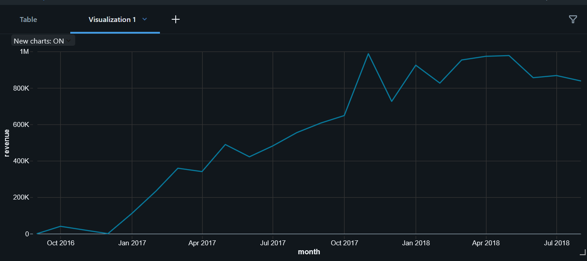
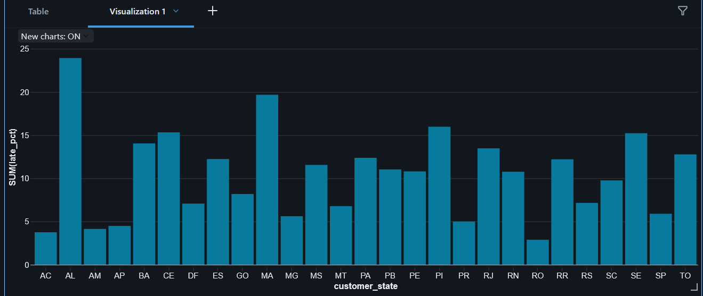
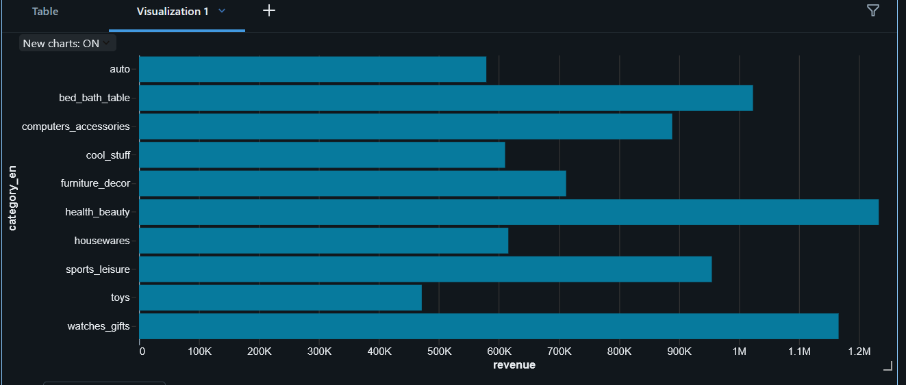
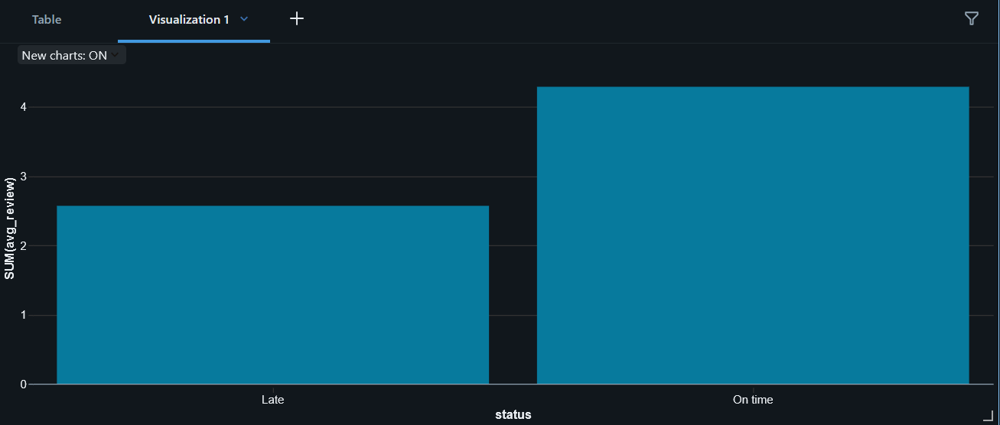

# olist-databricks-pipeline
# Olist E-Commerce Data Pipeline & Late-Delivery Prediction

An end-to-end data project on **Databricks (Free Edition)**: a bronze–silver–gold **PySpark / Delta Lake** pipeline over the Olist Brazilian e-commerce dataset, automated **data-quality checks**, business analysis of delivery performance, and a **late-delivery prediction model** (XGBoost vs logistic regression) tracked with **MLflow**.

## Business question
Late deliveries hurt customer satisfaction. Which orders are most at risk of arriving late, where is delivery performance weakest, and how much does lateness cost in customer reviews?

## Dataset
[Brazilian E-Commerce Public Dataset by Olist](https://www.kaggle.com/datasets/olistbr/brazilian-ecommerce) (Kaggle): about 100K orders from 2016–2018 across 9 CSV files (orders, order items, customers, payments, reviews, products, sellers, geolocation, category translation).

## Tech stack
PySpark · Databricks (serverless) · Delta Lake · SQL · MLflow · XGBoost · scikit-learn · pandas

## Pipeline architecture

| Layer | Notebook | What it does |
|---|---|---|
| Bronze | `01_bronze` | Ingests the 9 raw CSVs into Delta tables as-is, adding an `ingested_at` timestamp. |
| Silver | `02_silver` | Removes duplicates, parses timestamps, joins orders/items/customers/sellers/products/payments/reviews, adds English category names, and derives `delivery_days`, `estimated_days` and `is_late`. Runs the data-quality checks. |
| Gold | `03_gold` | Builds analytics tables: monthly revenue by category, delivery performance by state, seller performance, review score vs lateness, and customer metrics. |
| Model | `04_model` | Builds an order-level dataset, trains two models, and logs runs to MLflow. |

## Data quality
12 automated checks are run in `02_silver` and saved to a `dq_results` table (check name, failing rows, total rows, status, timestamp). They cover duplicates, null keys, orphan foreign keys, invalid prices, negative delivery times and join row loss.

**Result: 10 passed, 2 flagged.**
- 8 orders marked "delivered" have no delivery date.
- 610 products (about 1.9%) have no category and are labelled `unknown`.

## Key findings
- **96,478 delivered orders**, of which **8.11% arrived late**.
- **Lateness hurts reviews:** on-time orders average **4.29** stars, late orders average **2.57**.
- Late-delivery rates vary a lot by customer state, from about **3%** to about **24%**.
- Revenue grows steadily from late 2016 to roughly 1M per month, with a spike around Nov 2017.
- Top categories by revenue include `health_beauty`, `watches_gifts` and `bed_bath_table`.
- Only **3.05%** of customers placed more than one order.

## Late-delivery prediction (MLflow)
**Target:** whether a delivered order arrived after its estimated delivery date.

**Features (all known at purchase time):** number of items, item price, freight cost, total weight, number of sellers, estimated delivery days, payment installments, customer state, seller state, whether customer and seller share a state, payment type, purchase month and day of week. The review score is deliberately excluded because it is recorded after delivery and would leak the answer.

**Setup:** stratified 80/20 train/test split. XGBoost uses `scale_pos_weight` (about 11.3) to handle the imbalance (about 8% late). Logistic regression uses balanced class weights.

| Model | ROC-AUC | PR-AUC | F1 | Precision | Recall |
|---|---|---|---|---|---|
| Logistic regression (baseline) | 0.698 | 0.170 | 0.229 | 0.140 | 0.633 |
| XGBoost | 0.781 | 0.283 | 0.303 | 0.197 | 0.656 |

XGBoost parameters: 300 trees, max depth 5, learning rate 0.05, subsample 0.8, column sample 0.8.

**Top drivers (XGBoost feature importance):** customer in São Paulo (`customer_state_SP`), `same_state`, `purchase_month`, then other customer-state indicators. These are relative importance scores, not causal effects.

## Limitations
- XGBoost clearly beats the baseline, but precision is modest: at a 0.5 threshold most flagged orders are not actually late (precision 0.197 against an 8% base rate). The model is better at ranking risk than at making hard yes/no calls.
- The decision threshold was not tuned.
- The split is random, not time-based, so the results may be optimistic for future orders.
- Visuals are notebook charts rather than a published dashboard.

## Screenshots
Charts from `03_gold`:






## How to reproduce
1. Create a free [Databricks Free Edition](https://www.databricks.com/learn/free-edition) workspace.
2. In SQL, create the schema and volume:
   ```sql
   CREATE SCHEMA IF NOT EXISTS workspace.olist;
   CREATE VOLUME IF NOT EXISTS workspace.olist.raw;
   ```
3. Download the Olist dataset from Kaggle and upload all CSVs to `/Volumes/workspace/olist/raw/`.
4. Import the notebooks and run them in order: `01_bronze`, `02_silver`, `03_gold`, `04_model`.
   `04_model` installs XGBoost with `%pip install xgboost`, then needs a Python restart.

## Author
Krishna Pansari · [LinkedIn](https://www.linkedin.com/in/krishna-pansari-11886028b/) · [GitHub](https://github.com/pansarikrishna3)
